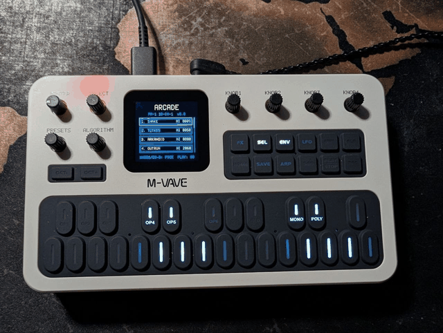
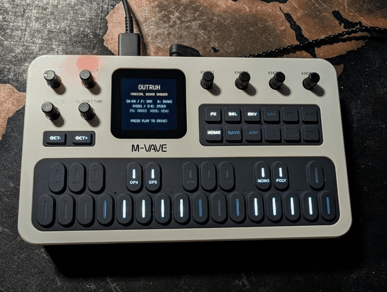
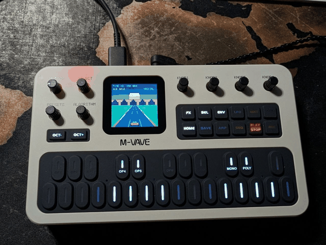

# Cozy FM-1 Games (`cozy-fm1-games`)

[](https://ko-fi.com/gaskb)

10-in-1 Arcade firmware for the **M-VAVE FM-1** pocket synthesizer, built on [Dinghy](https://github.com/zvenson/dinghy) (Felucca / SLOOP platform).



## On Real Hardware

| Arcade Menu | OutRun Title | OutRun Gameplay |
| :---: | :---: | :---: |
|  |  |  |

## What's New in `v0.8`

- **Per-game LED mapping**: active buttons and piano keys light up automatically for each game and menu screen.
- **10-in-1 Arcade**: Snake, Tetris (Korobeiniki BGM), Arkanoid (`KNOB1` paddle), OutRun (4-voice FM + drums OST), Synth Hero (7/12-key rhythm), Frogger, Galaga, Pac-Man, Chrome Dino Run, and Flappy Bird.
- **Unique identity (`FM-1_02700800`)** and `fmhub.json` ready for The Firmware Hub.

See [CHANGELOG.md](CHANGELOG.md) for the full version history.

## Games Included

1. **Snake** — 19×17 grid, directional eyes, progressive speed, chiptune SFX, persistent high score.
2. **Tetris** — Classic 10×20 board, all 7 tetrominoes with wall kicks, NEXT preview, **Korobeiniki 2-voice chiptune BGM** (`FX` toggles music), hard drop (`F` / `REC`).
3. **Arkanoid** — 5×9 colored bricks, smooth Q8 fixed-point physics, **rotary paddle control via `KNOB1` / `SELECT`**, 3 lives, level progression.
4. **OutRun** — Pseudo-3D raster road racer with sunset parallax, palm trees, traffic car, checkpoints, and **Magical Sound Shower / Passing Breeze / Splash Wave** 4-voice FM + drums BGM (`FX` cycles radio).
5. **Synth Hero** — Guitar Hero-style rhythm game synced to the OutRun MIDI tracks! **BASE** mode (7 white keys `C..B`) & **HIGH** mode (12 chromatic keys including `#`/`b`).
6. **Frogger** — Classic 13-row road & river crossing with 5 home lilypads.
7. **Galaga** — Scrolling starfield, swaying alien formation, dive-bombers, twin-laser starfighter.
8. **Pac-Man** — 19×19 maze, dots, blinking power pellets, 4 colored ghosts.
9. **Dino Run** — Chrome offline T-Rex runner with jumping, ducking, cacti, pterodactyls, and day/night cycles.
10. **Flappy Bird** — Classic pipe-dodging flyer with pentatonic synth notes on every flap.

All high scores are saved to flash (`STORE_MAGIC = "SNK1"`). Press **`HOME`** from any game to return to the Arcade menu.

## Controls

| Context | Input | Action |
| --- | --- | --- |
| **Menu** | `KNOB1` / `SELECT` / `C#` / `D` | Select game |
| **Menu** | `PLAY` / `E` / `F` | Launch game |
| **Snake** | `C` / `D` / `E` / `C#`–`D#` | Left / Down / Right / Up |
| **Snake** | `KNOB1` / `SELECT` | Turn left / right (90°) |
| **Tetris** | `C` / `E` / `D` | Move Left / Right / Soft Drop |
| **Tetris** | `C#`–`D#` / `KNOB1` | Rotate |
| **Tetris** | `F` / `REC` | Hard Drop |
| **Tetris** | `FX` | Toggle BGM (Korobeiniki) |
| **Arkanoid** | `KNOB1` / `SELECT` (or `C`/`E`) | Move paddle |
| **Arkanoid** | `PLAY` / `C#` / `F` | Launch ball / Pause |
| **Any game** | `HOME` | Return to Arcade menu |

## Per-Game LED Map (`v0.8`)

Starting in `v0.8`, active buttons and piano keys light up automatically to match the current screen (`arcade_update_leds` in `firmware/src/arcade_common.h`; `PLAY` lights up while a game is running, and `HOME` lights up in every game to return to the menu):

| Screen | Lit Buttons (besides `PLAY` / `HOME`) | Lit Piano Keys |
| --- | --- | --- |
| **Menu** | `ENV`, `SEL` | `C#`, `D#`, `D`, `E`, `F` |
| **Snake** | `OCT−`, `OCT+`, `ENV`, `SEL`, `FX`, `LFO` | `C`, `C#`, `D`, `D#`, `E` |
| **Tetris** | `OCT−`, `OCT+`, `ENV`, `SEL`, `FX`, `REC` | `C`, `C#`, `D`, `D#`, `E`, `F` |
| **Arkanoid** | `OCT−`, `OCT+` | `C`, `C#`, `D#`, `E`, `F` |
| **OutRun** | `OCT−`, `OCT+`, `ENV`, `SEL`, `FX` | `C`, `C#`, `D`, `D#`, `E`, `F` |
| **Synth Hero** | `OCT−`, `OCT+` | All white keys `C..B` (`C4..B4`, `C5..G5`) |
| **Frogger** | `OCT−`, `OCT+`, `ENV`, `SEL` | `C`, `C#`, `D`, `D#`, `E` |
| **Galaga** | `OCT−`, `OCT+`, `ENV` | `C`, `C#`, `D#`, `E`, `F` |
| **Pac-Man** | `OCT−`, `OCT+`, `ENV`, `SEL` | `C`, `C#`, `D`, `D#`, `E` |
| **Dino Run** | `ENV`, `SEL` | `C`, `C#`, `D`, `D#`, `E`, `F` |
| **Flappy Bird** | `ENV` | `C`, `C#`, `D`, `D#`, `E`, `F` |

## Build

Requires Docker (on macOS/Windows) or Linux x86-64, the JieLi toolchain (`./tools/get_toolchain.sh`), and `fw-AC79_AIoT_SDK`:

```sh
JIELI_TOOLCHAIN="$HOME/.jieli/toolchain" AC79_SDK="$HOME/fw-AC79_AIoT_SDK" ./build.sh --release 0.8
```

Output package: `build/cozy-fm1-games-0.8.fwsc` (identity `FM-1_02700800`).

## Credits & License

- Built on [Dinghy](https://github.com/zvenson/dinghy) by zvenson, based on [Felucca](https://github.com/hugelton/Felucca) (Leo Kuroshita / Hügelton Instruments) and [SLOOP](https://github.com/isod89/sloop-fm1) (isod89).
- Licensed under **GPL-3.0-only** — see [LICENSE](LICENSE) and [LICENSING.md](LICENSING.md).

## Support

Cozy FM-1 Games is free and open-source. If you enjoy it on your FM-1, feel free to [buy me a coffee on Ko-fi](https://ko-fi.com/gaskb) ☕!
